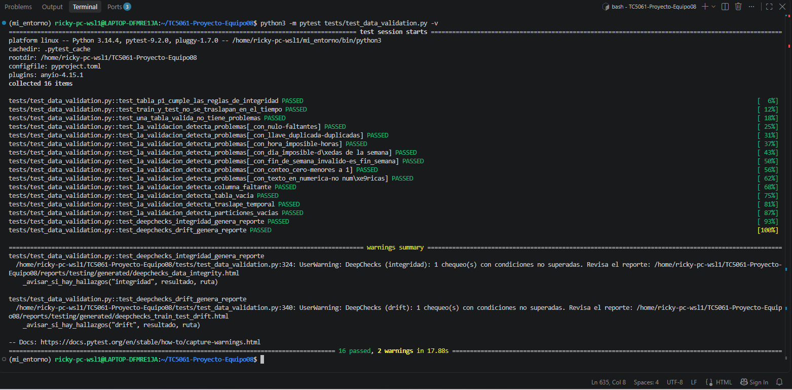
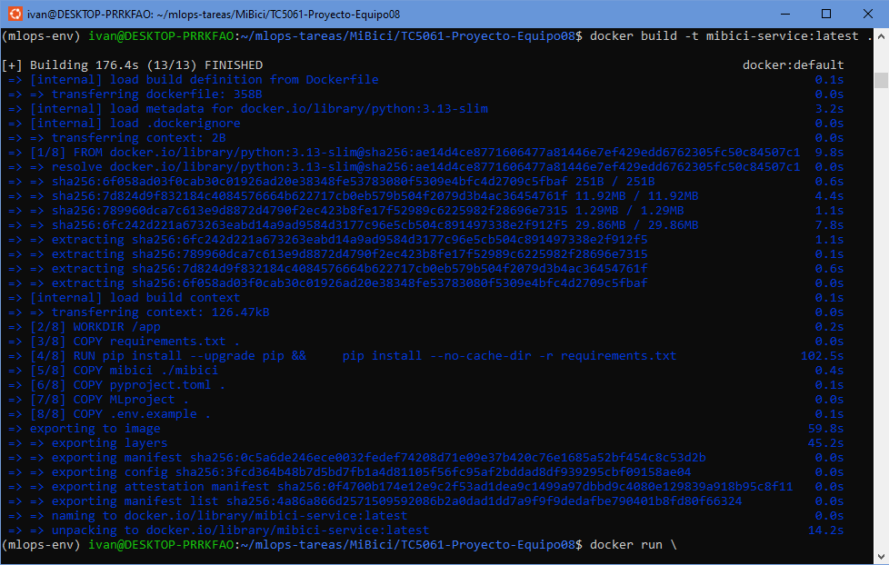
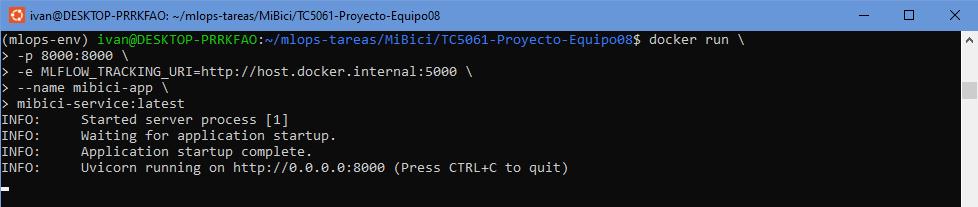
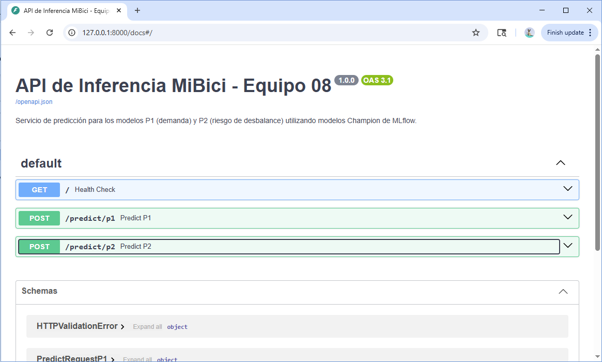
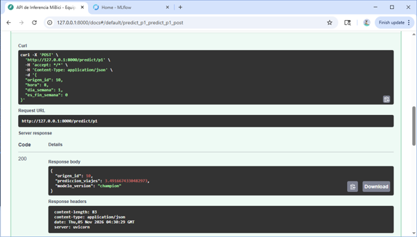
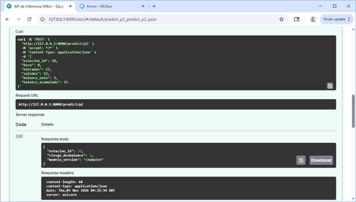

# Proyecto MiBici - Equipo 08

<a target="_blank" href="https://cookiecutter-data-science.drivendata.org/">
    
</a>

Proyecto colaborativo de MLOps y Machine Learning para el análisis y predicción de la demanda del sistema MiBici utilizando regresión, clasificación y clustering.

## Equipo y roles

| Integrante | Rol principal |
|------------|---------------|
| Ricardo | Data Engineer y Product Owner |
| Iván | MLOps Engineer, GitHub y gestión del repositorio |
| Tania | Data Scientist, modelado y MLflow |
| Jose Antonio | Documentación, ML Canvas y arquitectura |

### Responsabilidades compartidas

Todos los integrantes participan en:
- Revisión de Pull Requests
- Validación de decisiones técnicas
- Discusión de P1, P2 y P3
- Elaboración del entregable final

## Preguntas sobre MiBici

### P1. Predicción de demanda
¿Cuántos viajes se iniciarán en una estación durante un periodo futuro?

Problema de ML:
- Tipo: Regresión
- Modelo candidato: RandomForestRegressor
- Baseline: DummyRegressor

### P2. Riesgo de desbalance
¿Una estación presenta riesgo de quedarse sin bicicletas o sin espacios disponibles?

Problema de ML:
- Tipo: Clasificación
- Modelo candidato: RandomForestClassifier
- Baseline: DummyClassifier

### P3. Perfiles de uso
¿Qué grupos de estaciones presentan patrones horarios similares de utilización?

Problema de ML:
- Tipo: Clustering
- Modelo base: KMeans
- Métrica: Silhouette Score

## Datos

Fuente:
- Datos abiertos de MiBici Guadalajara.

Archivos utilizados:
- datos_abiertos_2026_01.csv
- datos_abiertos_2026_02.csv
- datos_abiertos_2026_03.csv
- datos_abiertos_2026_04.csv
- datos_abiertos_2026_05.csv

Los datos son descargados automáticamente durante la ejecución del pipeline de ingesta.

## Instalación

El equipo ejecutó el proyecto con Python 3.13 y 3.14.

```bash
python -m venv .venv
# Windows (PowerShell): .\.venv\Scripts\Activate.ps1
# Linux / macOS / WSL:   source .venv/bin/activate

pip install -r requirements.txt        # entrenamiento y MLflow
pip install -r requirements-dev.txt    # además: pruebas, DeepChecks y chequeos de seguridad
```

## Ingesta de datos

```bash
python -m mibici.dataset
```

Este comando:
- Descarga los datos abiertos de MiBici.
- Procesa los archivos CSV.
- Genera `viajes_clean.parquet`.
- Genera `data_manifest.json`.

## Ejecución de experimentos

Las corridas de entrenamiento, búsqueda y registro de modelos se lanzan con `mlflow run`
(ver la sección "Reproducción con MLflow Project" más abajo).

## Flujo de trabajo Git

El equipo seguirá GitHub Flow.

### Ramas

- main: rama protegida
- feature/ingestion
- feature/features
- feature/mlflow
- feature/docs

### Convención de commits

Se utilizará Conventional Commits:

- feat: nueva funcionalidad
- fix: corrección de errores
- docs: documentación
- refactor: reorganización de código
- test: pruebas
- chore: configuración o mantenimiento

### Pull Requests

Todo cambio debe realizarse en una rama de trabajo y fusionarse mediante Pull Request hacia `main`.


## Organización del proyecto

```text
TC5061-Proyecto-Equipo08
│
├── data/
│   ├── raw/                     <- Datos abiertos originales de MiBici (no se versionan)
│   └── processed/               <- Datos procesados y manifiesto (no se versionan)
│
├── docs/                        <- Documentación adicional del proyecto
│
├── mibici/                      <- Código fuente principal
│   ├── __init__.py
│   ├── config.py                <- Configuración global (rutas, fechas, semilla y MLflow)
│   ├── dataset.py               <- Ingesta y procesamiento de datos
│   ├── features.py              <- Generación de variables para modelado
│   ├── plots.py                 <- Generación de visualizaciones
│   └── modeling/
│       ├── __init__.py
│       ├── train.py             <- Baselines, búsqueda con nested runs y candidatas
│       ├── register.py          <- Registro de modelos y alias `champion`
│       └── predict.py           <- Inferencia y predicciones
│
├── models/                      <- Modelos serializados (cuando aplique)
│
├── notebooks/
│   └── P1_P2_P3_MiBici.ipynb    <- Análisis exploratorio y experimentación
│
├── references/
│   ├── Arquitectura_Equipo8.pdf <- Arquitectura de la solución
│   ├── ml_canvas.pdf            <- ML Canvas del proyecto
│   └── runs.csv
│
├── reports/
│   ├── figures/                 <- Figuras de análisis y evidencias de ejecución
│   ├── security/                <- Reportes de Bandit y pip-audit
│   └── testing/                 <- Reporte de PyTest y reportes HTML de DeepChecks
│
├── tests/
│   ├── test_data.py             <- Feature engineering y reproducibilidad
│   ├── test_ingesta.py          <- Limpieza de viajes y hash de datos
│   ├── test_modelado.py         <- Rejilla, candidatas, particiones y registro
│   └── test_data_validation.py  <- Calidad de datos y reportes de DeepChecks
│
├── .env                         <- Archivo local (excluido mediante .gitignore)
├── .env.example                 <- Plantilla pública de variables de entorno
├── .gitignore
├── Dockerfile                   <- Imagen para despliegue de la API REST
├── Makefile
├── MLproject                    <- Puntos de entrada de MLflow Project (ingest, train, register)
├── pyproject.toml
├── python_env.yaml              <- Entorno declarado para MLflow Project
├── requirements.txt             <- Dependencias de entrenamiento (versiones fijas)
├── requirements-dev.txt         <- Pruebas, DeepChecks y chequeos de seguridad
└── README.md
```

--------
ACTUALIZACIÓN 24OCT26

## Reproducción con MLflow Project

Todas las corridas se lanzan con `mlflow run`, nunca desde un notebook.
Los comandos son para PowerShell, desde la raíz del repositorio.

### 1. Entorno

```powershell
python -m venv .venv
.\.venv\Scripts\Activate.ps1
pip install -r requirements.txt
```

`python_env.yaml` y `requirements.txt` (versiones fijas) declaran el entorno del proyecto.
En Windows, `mlflow run` no puede crear ese entorno aislado porque necesita `pyenv`, que no
existe en ese sistema, por eso los comandos usan `--env-manager=local` (el Python del
`.venv` activo). En Linux/macOS se puede omitir esa opción.

### 2. Servidor de tracking (Terminal 1)

```powershell
mlflow server --backend-store-uri sqlite:///mlflow.db --port 5000
```

La interfaz queda en http://127.0.0.1:5000. `mlflow.db` y `mlartifacts/` están en el
`.gitignore` y nunca se suben al repositorio.

### 3. Ingesta y entrenamiento (Terminal 2)

```powershell
$env:MLFLOW_TRACKING_URI = "http://127.0.0.1:5000"

# Ingesta (descarga, limpia y genera viajes_clean.parquet + data_manifest.json)
mlflow run . -e ingest --experiment-name mibici-equipo08 --env-manager=local

# Baselines (DummyRegressor, DummyClassifier y KMeans k=2)
mlflow run . -e train --experiment-name mibici-equipo08 --env-manager=local -P question=p1 -P mode=baseline
mlflow run . -e train --experiment-name mibici-equipo08 --env-manager=local -P question=p2 -P mode=baseline
mlflow run . -e train --experiment-name mibici-equipo08 --env-manager=local -P question=p3 -P mode=baseline

# Búsqueda con nested runs: un padre por pregunta, una hija por combinación,
# y las 3 mejores se reentrenan como candidatas con artefactos completos
mlflow run . -e train --experiment-name mibici-equipo08 --env-manager=local -P question=p1 -P mode=search
mlflow run . -e train --experiment-name mibici-equipo08 --env-manager=local -P question=p2 -P mode=search
mlflow run . -e train --experiment-name mibici-equipo08 --env-manager=local -P question=p3 -P mode=search

# Reproducir una configuración concreta (el modelo elegido de cada pregunta)
mlflow run . -e train --experiment-name mibici-equipo08 --env-manager=local -P question=p1 -P mode=single -P model=rf -P n_estimators=300
```

Parámetros de `train`: `question` (p1|p2|p3), `mode` (baseline|search|single),
`model` (rf|hgb|logreg|all), `n_estimators`, `max_depth` (-1 = sin límite) y `n_clusters`.
Rutas, fechas y semilla viven en `mibici/config.py`.

### 4. Etiquetas para filtrar en la interfaz

Cada corrida lleva `equipo`, `question`, `model_family`, `stage_of_work`
(`baseline`, `search` o `candidate`), `run_role` (`parent` o `child`) y `git_commit`.
Ejemplo de filtro: `tags.question = "p2" and tags.stage_of_work = "candidate"`.

### 5. Artefactos de cada corrida candidata

| Carpeta | Contenido |
|---|---|
| `model/` | Modelo con firma y ejemplo de entrada |
| `plots/` | P1: real vs predicho y residuales. P2: matriz de confusión y curva precisión-recall. P3: perfiles horarios por grupo |
| `data/` | `data_manifest.json` (versión de los datos); P3 también `estaciones_cluster.csv` |
| `config/` | `run_config.json` y `config.py` con los que se ejecutó |

Además se registra el dataset de entrenamiento con `mlflow.log_input`. No se guardan
datos personales de las personas usuarias (solo estaciones, horas y conteos).

### 6. Model Registry y ciclo de vida

```powershell
mlflow run . -e register --experiment-name mibici-equipo08 --env-manager=local
```

Registra la mejor candidata de cada pregunta (elegida con la métrica de **validación**,
no la de prueba) como `mibici-equipo08-p1-demanda`, `mibici-equipo08-p2-riesgo` y
`mibici-equipo08-p3-grupos`, con descripción y linaje (corrida de origen, commit y
versión de datos) en los tags de cada versión.

**Esquema: aliases.** `champion` marca la versión en producción y, opcionalmente,
`challenger` la siguiente mejor. Se eligen aliases porque las etapas (Staging/Production)
están en desuso desde MLflow 2.9, y un alias permite cambiar de versión sin modificar el
código que consume el modelo: `models:/mibici-equipo08-p1-demanda@champion`.

```python
import mlflow
modelo = mlflow.pyfunc.load_model("models:/mibici-equipo08-p1-demanda@champion")
```

El script también genera `reports/tabla_comparativa.csv` para el reporte.

## 7. Pruebas automatizadas y chequeos de calidad

### Entorno de pruebas

Las herramientas de prueba y seguridad se instalan aparte del entorno de entrenamiento, para que
`mlflow run` no instale paquetes que no necesita.

```bash
python -m venv .venv
# Windows (PowerShell): .\.venv\Scripts\Activate.ps1
# Linux / macOS / WSL:   source .venv/bin/activate
pip install -r requirements-dev.txt
```

`requirements-dev.txt` incluye `requirements.txt` más PyTest, DeepChecks, Bandit y pip-audit
(y `setuptools` fijado, porque DeepChecks 0.19.1 requiere `pkg_resources`).

### Ejecución con un solo comando

```bash
python -m pytest tests -v
```

Se usa `python -m pytest` para que la raíz del proyecto quede en la ruta de importación y
las pruebas puedan importar el paquete `mibici`.

### Qué cubre cada archivo

| Archivo | Qué prueba |
|---|---|
| `tests/test_data.py` | Feature engineering de P1, P2 y P3 (caso normal y caso vacío) y reproducibilidad del entrenamiento (misma semilla, mismas predicciones) |
| `tests/test_ingesta.py` | Limpieza de viajes (cancelados, muy cortos o largos, edad imposible), límites de 1 y 240 minutos, lectura en latin-1 y hash SHA256 |
| `tests/test_modelado.py` | Conversión de `max_depth=-1`, rejilla de hiperparámetros, elección de candidatas, particiones temporales sin traslape, versión de datos y nombres del Model Registry |
| `tests/test_data_validation.py` | Validación de integridad y drift del dataset con DeepChecks |

### Evidencia

Reporte completo: [pytest Report](reports/testing/pytest_report.txt)


### Evidencia de ejecución de PyTest


## 8. Chequeos de seguridad

### Protección de archivos sensibles

El repositorio utiliza `.gitignore` para evitar la publicación accidental de archivos sensibles, artefactos temporales y recursos locales.

Elementos excluidos:

- `.env` y `.env.*`
- `mlflow.db`
- `mlruns/` y `mlartifacts/`
- `.venv/`
- `__pycache__/`
- `reports/testing/generated/`

Se verificó además que Git no rastrea archivos sensibles ni artefactos locales:

```bash
git ls-files .env
git ls-files mlflow.db
git ls-files | grep "^mlruns/"
```

Los comandos no devolvieron resultados: dichos recursos no forman parte del árbol versionado actual.

### Variables de entorno y configuración

Se revisó la gestión de configuración del proyecto en `mibici/config.py`.

Se identificó el uso de variables de entorno mediante `os.getenv()` para la configuración de MLflow:

```python
MLFLOW_TRACKING_URI = os.getenv(
    "MLFLOW_TRACKING_URI",
    "http://127.0.0.1:5000"
)

MLFLOW_EXPERIMENT_NAME = os.getenv(
    "MLFLOW_EXPERIMENT_NAME",
    "mibici-equipo08"
)
```
Se incluye un archivo .env.example que documenta las variables de entorno utilizadas por la configuración de MLflow. Contenido:

```text
MLFLOW_TRACKING_URI=http://127.0.0.1:5000
MLFLOW_EXPERIMENT_NAME=mibici-equipo08
```

El archivo .env local permanece excluido mediante .gitignore para evitar la publicación accidental de configuraciones específicas de cada entorno.

### Análisis estático de seguridad con Bandit

```bash
bandit -r mibici/
```

Reporte completo: [Bandit Report](reports/security/bandit_report.txt)


**Hallazgo inicial.** La primera ejecución (885 líneas de código) reportó 1 hallazgo de severidad baja (B110, `try/except/pass`) en `obtener_version_datos()` de `mibici/modeling/train.py`, que ignoraba en silencio los errores de lectura del manifiesto de datos. No hubo hallazgos de severidad media ni alta.

**Corrección.** La función ahora captura solo errores de lectura o de formato del manifiesto (`OSError`, `ValueError`, `AttributeError`, `TypeError`) y avisa por consola. Se agregaron pruebas en `tests/test_modelado.py` (PR #28).

**Resultado posterior a la corrección:** 0 hallazgos de severidad baja, media y alta (reporte y captura actualizados).

### Evidencia de ejecución de Bandit

Primera iteración:


Segunda iteración:


**Decisión para esta entrega.** El equipo acepta el riesgo y programa la actualización para la siguiente etapa, porque cada dependencia se usa en un contexto de exposición limitada y actualizar a mitad de la entrega puede alterar la reproducibilidad de los modelos ya registrados:

| Dependencia | Versión | Identificadores únicos | Corregida en | Justificación |
|---|---|---|---|---|
| GitPython | 3.1.45 | 34 | 3.2.1 | Solo se usa para leer el hash del commit del repositorio local |
| MLflow | 3.16.1 | 3 | 3.17.2 | El servidor de tracking corre localmente (127.0.0.1); actualizar puede requerir migrar `mlflow.db` |
| PyArrow | 21.0.0 | 1 | 23.0.1 | Solo lee y escribe archivos Parquet generados por el propio proyecto |
| Requests | 2.32.5 | 1 | 2.33.0 | Solo descarga los CSV públicos de MiBici |

### Historial de Git

Reporte completo: [pip-audit Report](reports/security/pip_audit_report.txt)

### Evidencia de ejecución de pip audit


**Resultado:** el reporte tiene 53 filas, que corresponden a 39 identificadores únicos (algunos aparecen repetidos) en 4 dependencias. El detalle de cada identificador se consulta con `pip-audit -r requirements.txt --desc`.

**Decisión para esta entrega.** El equipo acepta el riesgo y programa la actualización para la siguiente etapa, porque cada dependencia se usa en un contexto de exposición limitada y actualizar a mitad de la entrega puede alterar la reproducibilidad de los modelos ya registrados:

| Dependencia | Versión | Identificadores únicos | Corregida en | Justificación |
|---|---|---|---|---|
| GitPython | 3.1.45 | 34 | 3.2.1 | Solo se usa para leer el hash del commit del repositorio local |
| MLflow | 3.16.1 | 3 | 3.17.2 | El servidor de tracking corre localmente (127.0.0.1); actualizar puede requerir migrar `mlflow.db` |
| PyArrow | 21.0.0 | 1 | 23.0.1 | Solo lee y escribe archivos Parquet generados por el propio proyecto |
| Requests | 2.32.5 | 1 | 2.33.0 | Solo descarga los CSV públicos de MiBici |

### Historial de Git

El archivo `mlflow.db` estuvo versionado en commits anteriores y después se retiró y se agregó al `.gitignore`. Contiene metadatos de corridas (sin credenciales). No se reescribió el historial para no afectar las ramas del equipo; el árbol actual del repositorio no lo contiene.


## 9. Validación de datos con DeepChecks (actualizado y corregido el 08NOV26)

Las suites de validación de calidad de datos (`data_integrity`) y de cambio de distribución (`train_test_validation`) de DeepChecks se ejecutan de manera automatizada sobre las tablas de características de las tres preguntas del proyecto ($P1$, $P2$ y $P3$).

### Bitácora de Chequeos, Evaluaciones y Decisiones de Equipo

Con base en la evaluación de los reportes generados por DeepChecks para $P1$, $P2$ y $P3$, se documentan los chequeos con condiciones no superadas por defecto, sus valores y comportamientos observados, y la decisión técnica/operativa asumida por el equipo:

| Pregunta | Suite | Chequeo Evaluado | Valor / Alerta Observada | Decisión y Justificación del Equipo |
|---|---|---|---|---|
| **P1** (Demanda) | Data Integrity | *Data Duplicates* | 14.79% de combinaciones duplicadas | **Riesgo Aceptado.** Al agrupar por estación, hora y día de la semana, las combinaciones se repiten por construcción entre semanas. No son registros duplicados anómalos. |
| **P1** (Demanda) | Train-Test Drift | *New Category Train Test* | Nuevas categorías en `origen_id` (408-416) en Mayo | **Riesgo Aceptado.** Representa la expansión del sistema MiBici con nuevas estaciones en el periodo de prueba. Los modelos basados en árboles manejan categorías no vistas mediante valores por defecto. |
| **P2** (Riesgo) | Data Integrity | *Data Duplicates* | 5.49% de combinaciones duplicadas | **Riesgo Aceptado.** Estructura repetitiva esperada al consolidar indicadores por estación y hora. |
| **P2** (Riesgo) | Train-Test Drift | *New Category Train Test* | Nuevas categorías en `estacion_id` (408-417) en Mayo | **Balanceo y Robustez.** Se mantienen las estrategias de balanceo de clase (`class_weight='balanced'`) para garantizar generalización ante la incorporación de nuevas estaciones. |
| **P3** (Clustering) | Data Integrity | *Outliers / Integrity* | 0 chequeos fallidos | **Integridad Completa.** La matriz de perfiles horarios no presentó anomalías de formato o valores nulos. |
| **P3** (Clustering) | Train-Test Drift | *Feature Drift* | Drift score en proporciones por hora (`pct_hora_*`) | **Aceptado.** Muestra el cambio en la dinámica de movilidad urbana entre Enero-Abril y Mayo por factores climáticos. Los patrones de agrupamiento ($k=2$ a $k=6$) absorben este drift. |

### Generación de Reportes Evidenciales

Para ejecutar las suites en las tres preguntas, visualizar las alertas detalladas en consola y actualizar los reportes HTML en `reports/testing/generated/`, correr:

python -m pytest tests/test_data_validation.py -v -W ignore::DeprecationWarning



Evidencias generadas para la corrección 08NOV26:
1. `deepchecks_data_integrity_p1.html`
2. `deepchecks_data_integrity_p2.html`
3. `deepchecks_data_integrity_p3.html`
4. `deepchecks_train_test_drift_p1.html`
5. `deepchecks_train_test_drift_p2.html`
6. `deepchecks_train_test_drift_p3.html`


# Cambios 04NOV26, API REST y despliegue en contenedor Docker

Se completó la servitización e integración de los modelos de P1 (predicción de demanda) y P2 (riesgo de desbalance) mediante FastAPI y MLflow Model Registry. Se validó el servicio REST tanto de forma local como dentro de un contenedor Docker.

## Resumen del trabajo de esta actualización:

* **Estructura de la API REST:** se creó el módulo `mibici/api/` conteniendo `app.py` (servidor FastAPI) y `schemas.py` (modelos de datos Pydantic).
* **Validación de entradas:** implementación de los esquemas `PredictRequestP1` y `PredictRequestP2` mediante Pydantic para validar los datos de entrada de los endpoints de predicción de demanda y riesgo de desbalance.
* **Carga dinámica de modelos:** integración con MLflow Model Registry para consumir los modelos etiquetados con el alias `@champion`:

    - `models:/mibici-equipo08-p1-demanda@champion`
    - `models:/mibici-equipo08-p2-riesgo@champion`

* **Casting y compatibilidad de tipos:** ajuste explícito en la conversión de los datos de entrada a `float64` (`double`) para cumplir con la firma inferida por MLflow.
* **Endpoints disponibles:**

    - `POST /predict/p1`: predicción de demanda de viajes para una estación.
    - `POST /predict/p2`: predicción de riesgo de desbalance.

* **Pruebas y verificación local:** ejecución de la canalización de entrenamiento local (`-e train`), registro de modelos (`-e register`) y pruebas de los endpoints `/predict/p1` y `/predict/p2` en Swagger UI (`http://127.0.0.1:8000/docs`), confirmando respuestas exitosas `200 OK` con inferencias en tiempo real desde los modelos Champion registrados en MLflow.
* **Contenerización:** creación de un Dockerfile para empaquetar la API FastAPI y sus dependencias de inferencia.


## Despliegue con Docker

### Arquitectura de despliegue

La solución utiliza Docker para empaquetar y ejecutar la API REST desarrollada con FastAPI, junto con las dependencias necesarias para realizar inferencias.

La imagen incluye:

- Código fuente de la API (`mibici/api/`).
- Dependencias de ejecución definidas en `requirements.txt`.
- Base de datos de MLflow (`mlflow.db`), que contiene los metadatos del Model Registry.
- Artefactos de los modelos registrados (`mlruns/`).

Durante el inicio de la aplicación, FastAPI recupera los modelos P1 y P2 mediante sus respectivos aliases `champion` desde MLflow Model Registry.

**No se requiere iniciar un servidor MLflow externo**, ya que la API utiliza la base de datos SQLite y los artefactos incluidos en la imagen Docker.

### Construcción de la imagen

La imagen Docker fue construida exitosamente mediante el siguiente comando:

```bash
docker build -t mibici-api:1.2 .
```

#### Evidencia de construcción de la imagen



### Ejecución del contenedor

Una vez construida la imagen, se ejecuta el contenedor mediante:

```bash
docker run --rm -d \
  --name mibici-api \
  -p 8000:8000 \
  mibici-api:1.2
```

#### Evidencia de ejecución del contenedor



### Verificar el contenedor

Para comprobar que el contenedor está ejecutándose correctamente:

```bash
docker ps --filter name=mibici-api
```

Para consultar los registros de ejecución de la API:

```bash
docker logs mibici-api
```

### Documentación interactiva de la API (Swagger)

Una vez que el contenedor esté ejecutándose, se puede acceder a Swagger UI desde el navegador:

http://localhost:8000/docs

Desde esta interfaz es posible consultar los endpoints disponibles y probar las solicitudes de predicción de los modelos P1 y P2.



### Verificación de endpoints de P1 y P2

Se realizaron pruebas de los endpoints de predicción mediante solicitudes HTTP.

**Comando de ejemplo P1 – Predicción de demanda:**

```bash
curl -X POST \
  http://localhost:8000/predict/p1 \
  -H "Content-Type: application/json" \
  -d '{
    "origen_id": 10,
    "hora": 8,
    "dia_semana": 1,
    "es_fin_semana": 0
  }'
```

**Comando de ejemplo P2 – Predicción de riesgo de desbalance:**

```bash
curl -X POST \
  http://localhost:8000/predict/p2 \
  -H "Content-Type: application/json" \
  -d '{
    "estacion_id": 10,
    "hora": 8,
    "entradas": 15,
    "salidas": 12,
    "balance_neto": 3,
    "balance_acumulado": 25
  }'
```

Ambos endpoints fueron invocados exitosamente y los registros del contenedor confirmaron respuestas HTTP 200 OK.

**Ejecución y respuesta de P1 desde Swagger:**



**Ejecución y respuesta de P2 desde Swagger:**



### Detener el contenedor

Para detener la API:

```bash
docker stop mibici-api
```

Como el contenedor se inició con la opción `--rm`, Docker lo eliminará automáticamente después de detenerlo.

---
