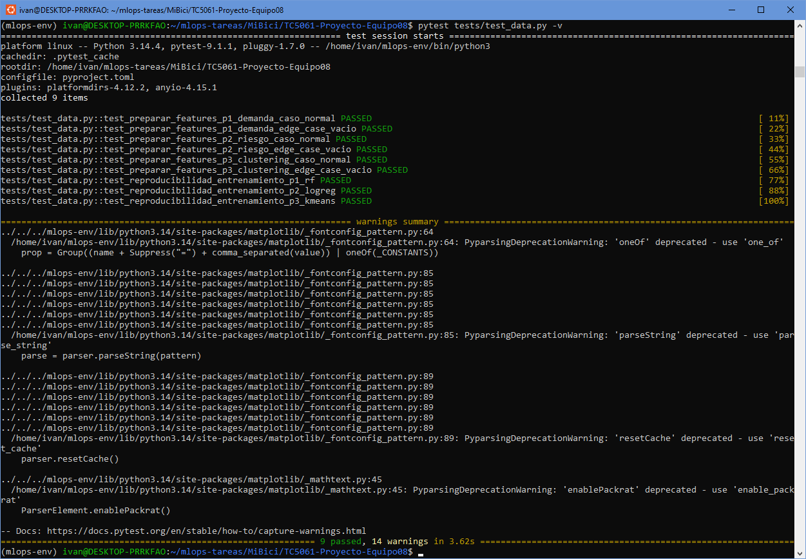
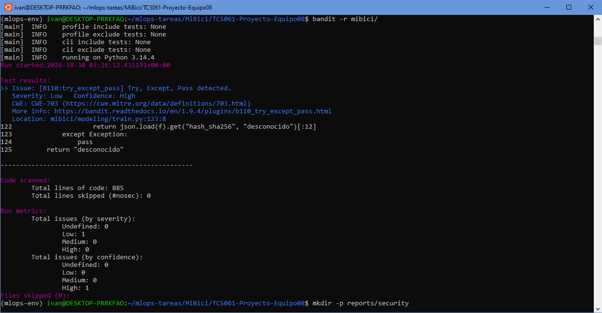
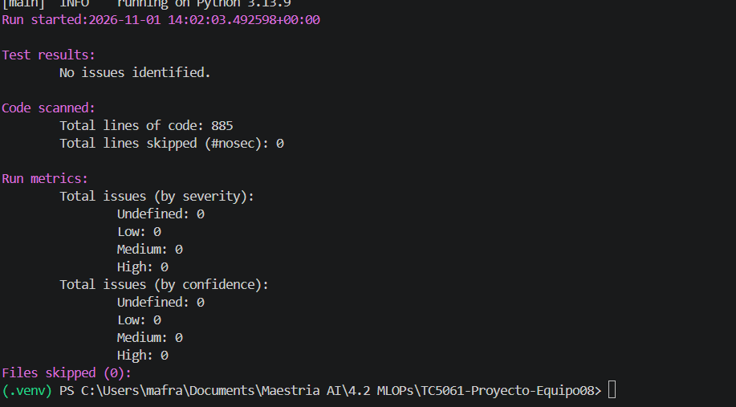
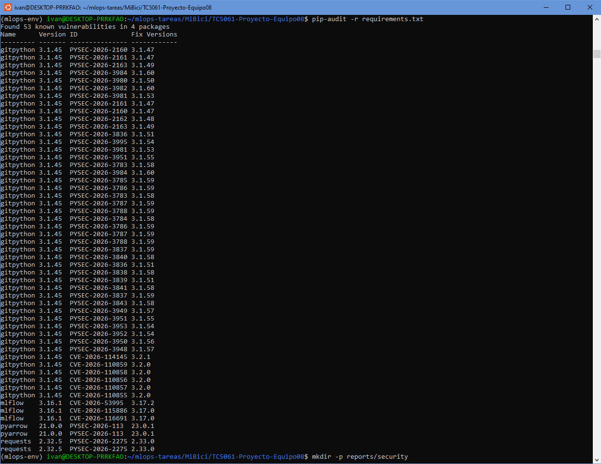

# Proyecto MiBici - Equipo 08

<a target="_blank" href="https://cookiecutter-data-science.drivendata.org/">
    
</a>

Proyecto colaborativo de MLOps y Machine Learning para el análisis y predicción de la demanda del sistema MiBici utilizando regresión, clasificación y clustering.

## Equipo y roles

| Integrante | Rol principal |
|------------|---------------|
| Ricardo | Data Engineer y Product Owner |
| Iván | MLOps Engineer, GitHub y gestión del repositorio |
| Tania | Data Scientist, modelado y MLflow |
| Jose Antonio | Documentación, ML Canvas y arquitectura |

### Responsabilidades compartidas

Todos los integrantes participan en:
- Revisión de Pull Requests
- Validación de decisiones técnicas
- Discusión de P1, P2 y P3
- Elaboración del entregable final

## Preguntas sobre MiBici

### P1. Predicción de demanda
¿Cuántos viajes se iniciarán en una estación durante un periodo futuro?

Problema de ML:
- Tipo: Regresión
- Modelo candidato: RandomForestRegressor
- Baseline: DummyRegressor

### P2. Riesgo de desbalance
¿Una estación presenta riesgo de quedarse sin bicicletas o sin espacios disponibles?

Problema de ML:
- Tipo: Clasificación
- Modelo candidato: RandomForestClassifier
- Baseline: DummyClassifier

### P3. Perfiles de uso
¿Qué grupos de estaciones presentan patrones horarios similares de utilización?

Problema de ML:
- Tipo: Clustering
- Modelo base: KMeans
- Métrica: Silhouette Score

## Datos

Fuente:
- Datos abiertos de MiBici Guadalajara.

Archivos utilizados:
- datos_abiertos_2026_01.csv
- datos_abiertos_2026_02.csv
- datos_abiertos_2026_03.csv
- datos_abiertos_2026_04.csv
- datos_abiertos_2026_05.csv

Los datos son descargados automáticamente durante la ejecución del pipeline de ingesta.

## Instalación


```bash
python -m venv mlops-env
source mlops-env/bin/activate

pip install -r requirements.txt
```


## Ingesta de datos

```bash
python -m mibici.dataset
```

Este comando:
- Descarga los datos abiertos de MiBici.
- Procesa los archivos CSV.
- Genera `viajes_clean.parquet`.
- Genera `data_manifest.json`.

## Ejecución de experimentos

```bash
python -m mibici.modeling.train
```

Este comando:
- Ejecuta P1 (regresión).
- Ejecuta P2 (clasificación).
- Ejecuta P3 (clustering).
- Registra métricas y artefactos en MLflow.

## Flujo de trabajo Git

El equipo seguirá GitHub Flow.

### Ramas

- main: rama protegida
- feature/ingestion
- feature/features
- feature/mlflow
- feature/docs

### Convención de commits

Se utilizará Conventional Commits:

- feat: nueva funcionalidad
- fix: corrección de errores
- docs: documentación
- refactor: reorganización de código
- test: pruebas
- chore: configuración o mantenimiento

### Pull Requests

Todo cambio debe realizarse en una rama de trabajo y fusionarse mediante Pull Request hacia `main`.


## Organización del proyecto

```text
TC5061-Proyecto-Equipo08
│
├── data/
│   ├── raw/                     <- Datos abiertos originales de MiBici
│   └── processed/               <- Datos procesados y manifiestos
│
├── docs/                        <- Documentación adicional del proyecto
│
├── mibici/                      <- Código fuente principal
│   ├── __init__.py
│   ├── config.py                <- Configuración global
│   ├── dataset.py               <- Ingesta y procesamiento de datos
│   ├── features.py              <- Generación de variables para modelado
│   ├── plots.py                 <- Generación de visualizaciones
│   └── modeling/
│       ├── __init__.py
│       ├── train.py             <- Entrenamiento y registro en MLflow
│       └── predict.py           <- Inferencia y predicciones
│
├── mlruns/                      <- Experimentos registrados por MLflow
│
├── models/                      <- Modelos serializados (cuando aplique)
│
├── notebooks/
│   └── P1_P2_P3_MiBici.ipynb    <- Análisis exploratorio y experimentación
│
├── references/
│   ├── Arquitectura_Equipo8.pdf <- Arquitectura de la solución
│   └── ml_canvas.pdf            <- ML Canvas del proyecto
│
├── reports/
│   ├── figures/                 <- Figuras de análisis y evidencias de ejecución
│   │   ├── pytest_execution.png
│   │   ├── bandit_execution.png
│   │   └── pip_audit_execution.png
│   ├── security/
│   │   ├── bandit_report.txt    <- Reporte de análisis estático de seguridad con Bandit
│   │   └── pip_audit_report.txt <- Reporte de auditoría de dependencias con pip-audit
│   └── testing/
│       └── pytest_report.txt    <- Reporte de ejecución de pruebas unitarias con PyTest
├── tests/
│   └── test_data.py             <- Pruebas unitarias y reproducibilidad
│
├── .env                         <- Archivo local (excluido mediante .gitignore)
├── .env.example                 <- Plantilla pública de variables de entorno
├── .gitignore
├── Makefile
├── pyproject.toml
├── requirements.txt
├── README.md
└── mlflow.db                    <- Base de datos local de tracking (excluida mediante .gitignore)
```

--------
ACTUALIZACIÓN 24OCT26

## Reproducción con MLflow Project

Todas las corridas se lanzan con `mlflow run`, nunca desde un notebook.
Los comandos son para PowerShell, desde la raíz del repositorio.

### 1. Entorno

```powershell
python -m venv .venv
.\.venv\Scripts\Activate.ps1
pip install -r requirements.txt
```

`python_env.yaml` y `requirements.txt` (versiones fijas) declaran el entorno del proyecto.
En Windows, `mlflow run` no puede crear ese entorno aislado porque necesita `pyenv`, que no
existe en ese sistema, por eso los comandos usan `--env-manager=local` (el Python del
`.venv` activo). En Linux/macOS se puede omitir esa opción.

### 2. Servidor de tracking (Terminal 1)

```powershell
mlflow server --backend-store-uri sqlite:///mlflow.db --port 5000
```

La interfaz queda en http://127.0.0.1:5000. `mlflow.db` y `mlartifacts/` están en el
`.gitignore` y nunca se suben al repositorio.

### 3. Ingesta y entrenamiento (Terminal 2)

```powershell
$env:MLFLOW_TRACKING_URI = "http://127.0.0.1:5000"

# Ingesta (descarga, limpia y genera viajes_clean.parquet + data_manifest.json)
mlflow run . -e ingest --experiment-name mibici-equipo08 --env-manager=local

# Baselines (DummyRegressor, DummyClassifier y KMeans k=2)
mlflow run . -e train --experiment-name mibici-equipo08 --env-manager=local -P question=p1 -P mode=baseline
mlflow run . -e train --experiment-name mibici-equipo08 --env-manager=local -P question=p2 -P mode=baseline
mlflow run . -e train --experiment-name mibici-equipo08 --env-manager=local -P question=p3 -P mode=baseline

# Búsqueda con nested runs: un padre por pregunta, una hija por combinación,
# y las 3 mejores se reentrenan como candidatas con artefactos completos
mlflow run . -e train --experiment-name mibici-equipo08 --env-manager=local -P question=p1 -P mode=search
mlflow run . -e train --experiment-name mibici-equipo08 --env-manager=local -P question=p2 -P mode=search
mlflow run . -e train --experiment-name mibici-equipo08 --env-manager=local -P question=p3 -P mode=search

# Reproducir una configuración concreta (el modelo elegido de cada pregunta)
mlflow run . -e train --experiment-name mibici-equipo08 --env-manager=local -P question=p1 -P mode=single -P model=rf -P n_estimators=300
```

Parámetros de `train`: `question` (p1|p2|p3), `mode` (baseline|search|single),
`model` (rf|hgb|logreg|all), `n_estimators`, `max_depth` (-1 = sin límite) y `n_clusters`.
Rutas, fechas y semilla viven en `mibici/config.py`.

### 4. Etiquetas para filtrar en la interfaz

Cada corrida lleva `equipo`, `question`, `model_family`, `stage_of_work`
(`baseline`, `search` o `candidate`), `run_role` (`parent` o `child`) y `git_commit`.
Ejemplo de filtro: `tags.question = "p2" and tags.stage_of_work = "candidate"`.

### 5. Artefactos de cada corrida candidata

| Carpeta | Contenido |
|---|---|
| `model/` | Modelo con firma y ejemplo de entrada |
| `plots/` | P1: real vs predicho y residuales. P2: matriz de confusión y curva precisión-recall. P3: perfiles horarios por grupo |
| `data/` | `data_manifest.json` (versión de los datos); P3 también `estaciones_cluster.csv` |
| `config/` | `run_config.json` y `config.py` con los que se ejecutó |

Además se registra el dataset de entrenamiento con `mlflow.log_input`. No se guardan
datos personales de las personas usuarias (solo estaciones, horas y conteos).

### 6. Model Registry y ciclo de vida

```powershell
mlflow run . -e register --experiment-name mibici-equipo08 --env-manager=local
```

Registra la mejor candidata de cada pregunta (elegida con la métrica de **validación**,
no la de prueba) como `mibici-equipo08-p1-demanda`, `mibici-equipo08-p2-riesgo` y
`mibici-equipo08-p3-grupos`, con descripción y linaje (corrida de origen, commit y
versión de datos) en los tags de cada versión.

**Esquema: aliases.** `champion` marca la versión en producción y, opcionalmente,
`challenger` la siguiente mejor. Se eligen aliases porque las etapas (Staging/Production)
están en desuso desde MLflow 2.9, y un alias permite cambiar de versión sin modificar el
código que consume el modelo: `models:/mibici-equipo08-p1-demanda@champion`.

```python
import mlflow
modelo = mlflow.pyfunc.load_model("models:/mibici-equipo08-p1-demanda@champion")
```

El script también genera `reports/tabla_comparativa.csv` para el reporte.

## 7. Pruebas unitarias con PyTest

Las pruebas automatizadas se encuentran en la carpeta `tests/`.

Para ejecutarlas:

```bash
python -m venv .venv
# Windows (PowerShell): .\.venv\Scripts\Activate.ps1
# Linux / macOS / WSL:   source .venv/bin/activate
pip install -r requirements-dev.txt
```

`requirements-dev.txt` incluye `requirements.txt` más PyTest, DeepChecks, Bandit y pip-audit
(y `setuptools` fijado, porque DeepChecks 0.19.1 requiere `pkg_resources`).

### Ejecución con un solo comando

```bash
python -m pytest tests -v
```

Se usa `python -m pytest` para que la raíz del proyecto quede en la ruta de importación y
las pruebas puedan importar el paquete `mibici`.

### Qué cubre cada archivo

| Archivo | Qué prueba |
|---|---|
| `tests/test_data.py` | Feature engineering de P1, P2 y P3 (caso normal y caso vacío) y reproducibilidad del entrenamiento (misma semilla, mismas predicciones) |
| `tests/test_ingesta.py` | Limpieza de viajes (cancelados, muy cortos o largos, edad imposible), límites de 1 y 240 minutos, lectura en latin-1 y hash SHA256 |
| `tests/test_modelado.py` | Conversión de `max_depth=-1`, rejilla de hiperparámetros, elección de candidatas, particiones temporales sin traslape, versión de datos y nombres del Model Registry |
| `tests/test_data_validation.py` | Validación de integridad y drift del dataset con DeepChecks |

### Evidencia

Reporte completo: [pytest Report](reports/testing/pytest_report.txt)


### Evidencia de ejecución de PyTest



## 8. Chequeos de seguridad

### Protección de archivos sensibles

El repositorio utiliza `.gitignore` para evitar la publicación accidental de archivos sensibles, artefactos temporales y recursos locales.

Elementos excluidos:

- `.env`
- `mlflow.db`
- `mlruns/`
- `mlartifacts/`
- `.venv/`
- `__pycache__/`

Revisión:
```bash
# Verificación de reglas de exclusión en .gitignore
grep -E "^(\.env|mlflow\.db|mlruns/|mlartifacts/|\.venv/|__pycache__)" .gitignore
# Respuesta:
__pycache__/
.env
mlruns/
mlartifacts/
mlflow.db
.venv/
mlruns/
mlartifacts/
mlflow.db
.env
.env.*
mlflow.db
```


Se verificó además que Git no rastrea archivos sensibles ni artefactos locales. Para ello se ejecutaron los siguientes comandos:

```bash
git ls-files .env
git ls-files mlflow.db
git ls-files | grep "^mlruns/"
```

Los comandos no devolvieron resultados, confirmando que dichos recursos no forman parte del repositorio versionado.

### Variables de entorno y configuración

Se revisó la gestión de configuración del proyecto en `mibici/config.py`.

Se identificó el uso de variables de entorno mediante `os.getenv()` para la configuración de MLflow:

```python
MLFLOW_TRACKING_URI = os.getenv(
    "MLFLOW_TRACKING_URI",
    "http://127.0.0.1:5000"
)

MLFLOW_EXPERIMENT_NAME = os.getenv(
    "MLFLOW_EXPERIMENT_NAME",
    "mibici-equipo08"
)
```
Se incluye un archivo .env.example que documenta las variables de entorno utilizadas por la configuración de MLflow. Contenido:

```text
MLFLOW_TRACKING_URI=http://127.0.0.1:5000
MLFLOW_EXPERIMENT_NAME=mibici-equipo08
```

El archivo .env local permanece excluido mediante .gitignore para evitar la publicación accidental de configuraciones específicas de cada entorno.

### Análisis estático de seguridad con Bandit

Se ejecutó un análisis estático del código fuente utilizando Bandit:

```bash
bandit -r mibici/
```

Reporte completo: [Bandit Report](reports/security/bandit_report.txt)


**Hallazgo inicial.** La primera ejecución (885 líneas de código) reportó 1 hallazgo de severidad baja (B110, `try/except/pass`) en `obtener_version_datos()` de `mibici/modeling/train.py`, que ignoraba en silencio los errores de lectura del manifiesto de datos. No hubo hallazgos de severidad media ni alta.

**Corrección.** La función ahora captura solo errores de lectura o de formato del manifiesto (`OSError`, `ValueError`, `AttributeError`, `TypeError`) y avisa por consola. Se agregaron pruebas en `tests/test_modelado.py` (PR #28).

**Resultado posterior a la corrección:** 0 hallazgos de severidad baja, media y alta (reporte y captura actualizados).


### Evidencia de ejecución de Bandit

Primera iteración:


Segunda iteración:


### Auditoría de dependencias con pip-audit

Se ejecutó la revisión de dependencias:

```bash
pip-audit -r requirements.txt
```

Reporte completo: [pip-audit Report](reports/security/pip_audit_report.txt)

### Evidencia de ejecución de pip audit




**Resultado:** el reporte tiene 53 filas, que corresponden a 39 identificadores únicos (algunos aparecen repetidos) en 4 dependencias. El detalle de cada identificador se consulta con `pip-audit -r requirements.txt --desc`.

**Decisión para esta entrega.** El equipo acepta el riesgo y programa la actualización para la siguiente etapa, porque cada dependencia se usa en un contexto de exposición limitada y actualizar a mitad de la entrega puede alterar la reproducibilidad de los modelos ya registrados:

| Dependencia | Versión | Identificadores únicos | Corregida en | Justificación |
|---|---|---|---|---|
| GitPython | 3.1.45 | 34 | 3.2.1 | Solo se usa para leer el hash del commit del repositorio local |
| MLflow | 3.16.1 | 3 | 3.17.2 | El servidor de tracking corre localmente (127.0.0.1); actualizar puede requerir migrar `mlflow.db` |
| PyArrow | 21.0.0 | 1 | 23.0.1 | Solo lee y escribe archivos Parquet generados por el propio proyecto |
| Requests | 2.32.5 | 1 | 2.33.0 | Solo descarga los CSV públicos de MiBici |

### Historial de Git

El archivo `mlflow.db` estuvo versionado en commits anteriores y después se retiró y se agregó al `.gitignore`. Contiene metadatos de corridas (sin credenciales). No se reescribió el historial para no afectar las ramas del equipo; el árbol actual del repositorio no lo contiene.

## 9. Validación de datos con DeepChecks

```powershell
$env:DEEPCHECKS_GUARDAR_EVIDENCIA = "1"
python -m pytest tests/test_data_validation.py -q
Remove-Item Env:DEEPCHECKS_GUARDAR_EVIDENCIA
```

`tests/test_data_validation.py` valida la tabla de demanda de P1 (estación x fecha x hora), que no
contiene datos personales. Usa `data/processed/viajes_clean.parquet` y, si no existe, viajes
sintéticos con el mismo esquema. Entrenamiento (enero-abril) y prueba (mayo) se separan con las
fechas de `mibici/config.py`, igual que en el modelado.

| Tipo | Qué revisa | Resultado |
|---|---|---|
| Reglas de calidad (pandas) | Valores faltantes, filas duplicadas en la llave (estación, fecha, hora), tipos numéricos, rangos (hora 0-23, día 0-6, conteo >= 1) y separación temporal entre entrenamiento y prueba | **La prueba falla** si no se cumplen |
| DeepChecks `data_integrity` | Reporte de integridad del entrenamiento | Se genera el HTML y se avisa si hay condiciones no superadas |
| DeepChecks `train_test_validation` | Drift entre entrenamiento y prueba | Se genera el HTML y se avisa si hay condiciones no superadas |

Los hallazgos de DeepChecks **se reportan sin hacer fallar la prueba**: sus condiciones por defecto
(por ejemplo, 0 % de duplicados) no aplican a esta tabla, porque al quitar la fecha las combinaciones
de variables se repiten entre días por construcción, y entre enero-abril y mayo es esperable un drift
estacional. Las reglas que sí son errores de calidad se verifican de forma explícita.

Los reportes se guardan en `reports/testing/generated/` (ignorada por Git). Para actualizar la
evidencia versionada:
- [Data Integrity](reports/testing/deepchecks_data_integrity.html)
- [Test Drift](reports/testing/deepchecks_train_test_drift.html)


**Limitación conocida:** DeepChecks 0.19.1 usa `pkg_resources` (de ahí `setuptools==69.5.1`) y
requiere parches de compatibilidad con NumPy 2 y scikit-learn, que están en el propio archivo de
pruebas. Con scikit-learn 1.8 o superior podría fallar y habría que actualizar DeepChecks.
